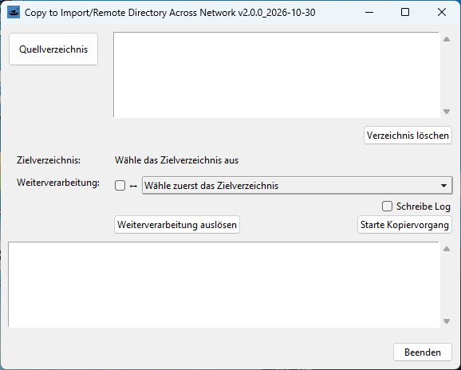

# Cirdan
## Copy to Import/Remote Directory Across Network


Copy directories to a fixed destination and build md5 hashes. Some criteria are checked while selecting the source directory.

The GUI is close to a well known copy tool so the old dogs don´t need to learn new tricks.

Works on Windows and Linux. Uploads use the bundled `copymd5` tool; the update installer mirrors files with pathlib.
## Requirements
Python 3.14 or newer.

In addition to the standard libraries `PyInstaller` is required in case you want to build executables:

```
python -m pip install pyinstaller
```
In case your machine is offline, download the libraries on an online system:

```
python -m pip download pyinstaller
```
Transport the .whl files to the offline machine and execute:
```
python -m pip install --no-index --find-links .\ pyinstaller
```
## Installation
You might use git:
```
git clone https://codeberg.org/markusthilo/Cirdan.git
```
If you want to generate executables to copy and run the tool in an environment without Python, change into the Cirdan directory and use the make script:
```
cd Cirdan
python make.py
```
To copy the Cirdan directory it is possible to use the downloader script that is primarily intended to update an installed version:
```
python downloader.py .\ destination-dir\
```
or
```
downloader.exe .\ destination-dir\
```
if you have built executables.
## Configuration
The configuration files are in JSON file format:
- `config.json`: admin given parameters as domain, paths etc.
- `gui.json`: basic parameters for the GUI
By default there are language packs for English (`labels_en.json`) and German (`labels_de.json`).
### Example `config.json`
```
{
    "app_name": "Cirdan",
    "labels_path": "$APP/labels_de.json",
    "local_path": "$HOME/AppData/Local/Cirdan/",
    "target_path": "$HOME/Documents/",
    "log_path": "$HOME/Documents/_logs/",
    "update_path": "P:/Cirdan/",
    "domain": "example.net",
    "settings_name": "settings.json",
    "destinations": {
        "Import directory 1": {"sub_path": "import1", "todo": "selection"},
        "Import directory 2": {"sub_path": "import2", "todo": "static"},
        "Import directory 3": {"sub_path": "import3", "todo": "static"}
    },
    "todo_name": "metadata.txt",
    "todo": {
        "static": {
            "Only task": "task 1",
            "Do nothing": null
        },
        "selection": {
            "Task 1": "task 1",
            "Task 2": "task 2",
            "Task 3": "task 3",
            "Do nothing": null
        }
    },
    "log_name": "log.txt",
    "lastlog_name": "lastlog.txt",
    "crashlog_name": "crashlog.txt",
    "tsv_name": "md5.txt",
    "trigger_name": "ready.txt",
    "todo_name": "todo.txt",
    "qualicheck_name": "qualicheck.txt",
    "source_whitelist": [
        "^[0-9]{6}-([0-9]{4}|[0-9]{6})-(([iZ0-9][0-9]{5})|(StA[0-9]{3}))/(EAV|MSD)[0-9]{2}[A-Z]{3}[0-9A-Z]{4}.*"
    ],
    "max_path_length": 230,
	"max_hash_size": 1073741824,
    "source_blacklist": [
        "^[^/]+/(?!((EAV|MSD)[0-9]{2}[A-Z]{3}[0-9A-Z]{4})|(.*\\.(txt|pdf)$))",
        ".*/Help/HTML5/.*",
        ".*/Help/LicenseUpgrade/.*"
    ],
    "destination_blacklist": [
        "^[^/]*/ready.txt",
        "^[^/]*/error.txt",
        "^[^/]*/start.txt",
        "^[^/]*/delete.txt"
    ],
	"mail": {
        "smtp_host": "smtpt.example.net",
        "smtp_port": 25,
        "smtp_timeout": 30,
        "From": "From <from@example.net>",
        "Reply-To": "reply-to@example.net",
        "Default-Subject": "Cirdan: upload has finished",
        "body": "Dear user,\n\nthis is message generated by Cirdan, the upload tool for geeks.\n\nThe upload is complete.\n\nDirectory: %\nSize: %\nFiles: %\nNot copied: %\nCorrupt files: %\n\nRegards,\n\nSupport-Team\n"
    }
}
```
## Usage
- Launch the GUI:
```
python cirdan.py
```
- Launch with a preselected directory:
```
python cirdan.py -g directory-to-upload\
```
- Learn command line usage:
```
python cirdan.py -h
```
Having executables, double clicking `cirdan.exe` should work.
## Legal Notice
### License
MIT License

Copyright (c) 2026 Markus Thilo

https://opensource.org/license/MIT

### Disclaimer
This is not a commercial product with an army of developers and a department for quality control behind it. The author is not responsible for any malfunction and/or lost data. Use the software at your own risk.
