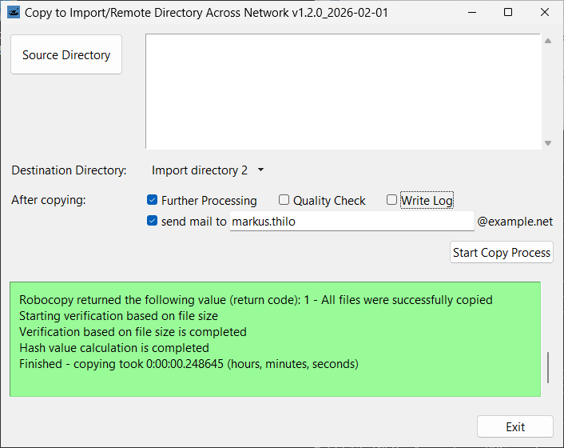

# Cirdan
## Copy to Import/Remote Directory Across Network


Kopiert Verzeichnisse zu einem festen Ziel und erstellt MD5-Hashes. Einige Kriterien werden beim Auswählen des Quellverzeichnisses überprüft.

Die GUI ist einem bekannten Kopiertool ähnlich, damit alte Hasen keine neuen Tricks lernen müssen.

RoboCopy wird verwendet, daher ist dies für Windows.
## Anforderungen
Python 3.13 funktioniert einwandfrei. Neuere Versionen sollten kein Problem darstellen.

Zusätzlich zu den Standardbibliotheken wird `PyInstaller` benötigt, falls Sie ausführbare Dateien erstellen möchten:

```
python -m pip install pyinstaller
```
Falls Ihr Rechner offline ist, laden Sie die Bibliotheken auf einem Online-System herunter:

```
python -m pip download pyinstaller
```
Transportieren Sie die .whl-Dateien zum Offline-Rechner und führen Sie aus:
```
python -m pip install --no-index --find-links .\ pyinstaller
```
## Installation
Sie können git verwenden:
```
git clone https://codeberg.org/markusthilo/Cirdan.git
```
Wenn Sie ausführbare Dateien generieren möchten, um das Tool in einer Umgebung ohne Python zu kopieren und auszuführen, wechseln Sie in das Cirdan-Verzeichnis und verwenden Sie das Make-Skript:
```
cd Cirdan
python make.py
```
Um das Cirdan-Verzeichnis zu kopieren, ist es möglich, das Downloader-Skript zu verwenden, das hauptsächlich dazu gedacht ist, eine installierte Version zu aktualisieren:
```
python downloader.py .\ ziel-verzeichnis\
```
oder
```
downloader.exe .\ ziel-verzeichnis\
```
falls Sie ausführbare Dateien erstellt haben.
## Konfiguration
Die Konfigurationsdateien sind im JSON-Dateiformat:
- `config.json`: vom Administrator vorgegebene Parameter wie Domain, Pfade usw.
- `gui.json`: grundlegende Parameter für die GUI
Standardmäßig gibt es Sprachpakete für Englisch (`labels_en.json`) und Deutsch (`labels_de.json`).
### Beispiel `config.json`
```
{
    "labels_path": "$APP/labels_de.json",
    "mail_template_path": "$APP/mail_template.json",
    "local_path": "$HOME/AppData/Local/Cirdan/",
    "target_path": "$HOME/Documents/",
    "log_path": "$HOME/Documents/_logs/",
    "mail_path": "$HOME/Documents/_mail/",
    "update_path": "P:/Cirdan/",
    "domain": "example.net",
    "destinations": {
        "Import-Verzeichnis 1": "import1",
        "Import-Verzeichnis 2": "import2",
        "Import-Verzeichnis 3": "import3"
    },
    "settings_name": "settings.json",
    "log_name": "log.txt",
    "lastlog_name": "lastlog.txt",
    "tmplog_name": "tmplog.txt",
    "crashlog_name": "crashlog.txt",
    "tsv_name": "md5.txt",
    "trigger_name": "trigger.txt",
    "qualicheck_name": "qualicheck.txt",
    "mail_name": "CIRDAN.json",
    "source_whitelist": [
        "^[0-9]{6}-.*"
    ],
    "max_path_length": 230,
    "source_blacklist": [
        "^[^/]*/(?!EAV[0-9A-Z]{9})(?![^/]*\\.(pdf|txt)$).*$",
        ".*/forbidden.txt$",
        ".*/not_allowed/.*"
    ],
    "destination_blacklist": [
        "^[^/]*/trigger.txt",
        "^[^/]*/qualicheck.txt",
        "^[^/]*/done.txt"
    ]
}
```
## Verwendung
- GUI starten:
```
python cirdan.py
```
- Mit einem vorausgewählten Verzeichnis starten:
```
python cirdan.py -g quellverzeichnis\
```
- Kommandozeilen-Verwendung:
```
python cirdan.py -h
```
Bei vorhandenen ausführbaren Dateien sollte ein Doppelklick auf `cirdan.exe` funktionieren.
## Rechtlicher Hinweis
### Lizenz
MIT-Lizenz

Copyright (c) 2025 Markus Thilo

https://opensource.org/license/MIT

### Haftungsausschluss
Hinter dieser Software steht aktuell ein Entwickler, keine Armee von Informatikern und einer Qualitätssicherungsabteilung. Der Autor ist nicht verantwortlich für Fehlfunktionen und/oder Datenverlust. Verwenden Sie die Software auf eigenes Risiko.